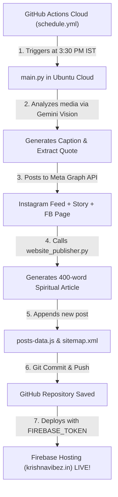

# 🪷 Krishna Vibez — संपूर्ण प्रोजेक्ट डॉक्यूमेंटेशन (Master Project Memory)

> **आधिकारिक डोमेन:** `https://krishnavibez.in`  
> **थीम:** दैनिक दिव्य दर्शन, भगवद्गीता सार, 4K HD वॉलपेपर्स एवं 4K वीडियो रील्स  
> **सोशल मीडिया एकाउंट्स:**
> - **Instagram:** [@pareshpadsala_](https://www.instagram.com/pareshpadsala_/)
> - **Facebook Page:** [Krishna Vibez (ID: 1808917602588221)](https://www.facebook.com/1808917602588221)

---

## 📌 1. प्रोजेक्ट का उद्देश्य (Project Vision)

**Krishna Vibez** एक प्रीमियम, आधुनिक और मोबाइल-फ्रेंडली आध्यात्मिक वेब पोर्टल है, जिसे भगवान श्री कृष्ण के पावन सुविचार, श्रीमद्भगवद्गीता के अमर उपदेश, उच्च गुणवत्ता वाले 4K HD वॉलपेपर्स और 4K वीडियो रील्स को दुनिया भर के श्रद्धालुओं तक निःशुल्क पहुँचाने के लिए बनाया गया है।

### मुख्य विशेषताएं:
1. **0 सर्वर, 0 मंथली कॉस्ट:** वेबसाइट पूरी तरह क्लाउड-होस्टेड (Firebase Hosting) और CDN-इनेबल्ड है। 2000+ इमेजेस और वीडियो रील्स बिना किसी महंगे सर्वर के लोड होती हैं।
2. **Google AdSense रेडी:** 5 कानूनी पृष्ठ (About, Privacy Policy, Terms, Disclaimer, Contact), 400+ शब्दों के विस्तृत ज्ञानवर्धक आर्टिकल्स और विज्ञापन स्लॉट्स पहले से तैयार हैं।
3. **ऑटोमेशन कम्पैटिबल:** Instagram और Facebook पर रोज़ाना होने वाली पोस्ट्स अपने आप वेबसाइट पर भी आर्टिकल, वॉलपेपर और रील के रूप में पब्लिश हो जाती हैं।

---

## 📁 2. संपूर्ण फ़ाइल संरचना (Project Architecture)

```
E:\Paresh\Auto Post\Krishna Vibez\
│
├── PROJECT_DOCUMENTATION.md          <-- यह फ़ाइल (पूरी प्रोजेक्ट मेमोरी व गाइड)
├── README.md                         <-- संक्षेप में प्रोजेक्ट विवरण व कमांड्स
├── logo.png                          <-- 4K ब्रांड लोगो (मोरपंख + स्वर्णिम बांसुरी)
├── firebase.json                     <-- Firebase Hosting व सुरक्षा हेडर कॉन्फ़िगरेशन
├── .firebaserc                       <-- Firebase प्रोजेक्ट मैपिंग
├── auto_publish_krishna_vibez.py     <-- ऑटोमेशन स्क्रिप्ट (पोस्ट्स को वेबसाइट में जोड़ने के लिए)
│
└── public/                           <-- वेब रूट (यह पूरा फ़ोल्डर होस्ट होता है)
    ├── index.html                    <-- होमपेज (फ़ीड, सर्च, फ़िल्टर, बांसुरी धुन, सोशल लिंक्स)
    ├── post.html                     <-- सिंगल पोस्ट व्यू (400-शब्द आर्टिकल, 4K डाउनलोड, शेयर, कमेंट्स)
    ├── about.html                    <-- हमारे बारे में (AdSense अनिवार्य)
    ├── contact.html                  <-- संपर्क करें (AdSense अनिवार्य + वर्किंग फ़ॉर्म)
    ├── privacy-policy.html           <-- गोपनीयता नीति (AdSense अनिवार्य)
    ├── terms.html                    <-- नियम एवं शर्तें (AdSense अनिवार्य)
    ├── disclaimer.html               <-- अस्वीकरण (AdSense अनिवार्य)
    ├── sitemap.xml                   <-- Google Search Console साइटमैप
    ├── robots.txt                    <-- सर्च इंजन बॉट निर्देश
    │
    ├── assets/
    │   └── logo.png                  <-- वेबसाइट फ़ेविकॉन व लोगो
    │
    ├── css/
    │   └── style.css                 <-- लग्जरी ग्लासमोर्फिज़्म डार्क थीम स्टाइलशीट
    │
    └── js/
        ├── posts-data.js             <-- सभी वॉलपेपर्स व रील्स का मास्टर डेटाबेस
        └── app.js                    <-- कोर इंजन (डाउनलोडर, सिक्योरिटी, मेट्रिक्स, ऑडियो)
```

---

## ⚙️ 3. प्रोजेक्ट में किए गए सभी प्रमुख कार्य (Work Done Log)

### A. 4K Reels (Video) सपोर्ट का इंटीग्रेशन
- **समस्या:** पहले वेबसाइट केवल स्थिर तस्वीरों (Images) के लिए बनी थी, जबकि सोशल मीडिया पर रोज़ाना रील्स (Videos) भी पोस्ट होती हैं।
- **समाधान:**
  1. `posts-data.js` में `mediaType: "video"` और `videoUrl` सपोर्ट जोड़ा गया।
  2. होमपेज ग्रिड में रील्स के लिए वीडियो प्लेयर, **"▶" प्ले ओवरले** और होवर-प्ले इफ़ेक्ट जोड़ा गया।
  3. डिटेल पेज (`post.html`) में रेस्पॉन्सिव 4K वीडियो प्लेयर और **"⬇️ 4K Reel डाउनलोड (MP4)"** बटन जोड़ा गया।
  4. केटेगरी फ़िल्टर बार में **"🎬 4K Reels"** का अलग फ़िल्टर टैब अपने आप तैयार हो जाता है।

### B. डायरेक्ट डाउनलोड इंजन फिक्स (.jpg और .mp4)
- **समस्या:** क्रोमियम ब्राउज़र में क्रॉस-ऑरिजिन CDN इमेजेस डाउनलोड करने पर उनका नाम बिना एक्सटेंशन (`ba17a929-...`) का हो जाता था और फ़ाइल विंडोज़ फ़ोटो में नहीं खुलती थी।
- **समाधान:**
  1. `app.js` में `downloadHdWallpaper()` को अपग्रेड किया गया।
  2. इमेजेस के लिए `FileReader.readAsDataURL()` का उपयोग करके ब्लॉब को टाइप-सेफ बेस64 Data URL (`image/jpeg`) में बदला गया।
  3. वीडियो रील्स के लिए टाइप-सेफ `video/mp4` ब्लॉब यूआरएल और 60-सेकंड ऑटो-रिवोक टाइमर लगाया गया।
  4. अब हर डाउनलोड सीधे आपके **Downloads फ़ोल्डर में असली `.jpg` और `.mp4`** के रूप में सेव होता है और तुरंत खुलता है।

### C. Google Search & Images SEO (Alt Text & Titles)
- **समस्या:** इमेजेस और रील्स Google सर्च व इमेज सर्च में रैंक नहीं हो रही थीं।
- **समाधान:**
  1. `posts-data.js` में हर पोस्ट के लिए कस्टम, कीवर्ड-रिच `altText` जोड़ा गया।
  2. `app.js` में डायनामिक `getSeoAltText(post, isVideo)` फ़ंक्शन बनाया गया।
  3. हर `` टैग में `alt="..."` और `title="..."` जोड़ा गया (उदा: *"भगवद्गीता कर्मयोग 4K वॉलपेपर — कर्म करो फल की चिंता मत करो — श्री कृष्ण सुविचार Krishna Vibez"*).
  4. हर `<video>` टैग में `title="..."` और `aria-label="..."` जोड़ा गया (उदा: *"श्री कृष्ण 4K दिव्य रील वीडियो — जीवन का मतलब खुद को खोना नहीं, खुद को पाना है — Krishna Vibez Reels WhatsApp Status"*).
  5. इससे Google Images और Google Video Search बॉट्स कंटेंट को तुरंत पहचानकर उच्च रैंकिंग देते हैं।

### D. लाइव सोशल मीडिया फॉलो बटन्स (Instagram & Facebook)
- **Instagram:** `https://www.instagram.com/pareshpadsala_/` (@pareshpadsala_)
- **Facebook:** `https://www.facebook.com/1808917602588221` (Krishna Vibez)
- **कहाँ-कहाँ जोड़े गए:**
  1. **नेविगेशन बार (Header):** सभी पेजों के टॉप-नेव में Instagram (पिंक ग्रेडिएंट) और Facebook (ब्लू) के आकर्षक बटन।
  2. **होमपेज हीरो सेक्शन:** सर्च बार के ठीक नीचे *"✨ सोशल मीडिया पर फॉलो करें:"* की खूबसूरत पिल स्ट्रिप।
  3. **आर्टिकल पेज (`post.html`):** हर पोस्ट पढ़ने के बाद कमेंट्स से ठीक ऊपर फॉलो सीटीए बॉक्स।
  4. **फुटर:** *"दैनिक सत्संग से जुड़ें"* कॉलम में डायरेक्ट फॉलो बटन्स।

### E. लाइव मेट्रिक्स और कमेंट्स सिस्टम
- **रियल-टाइम काउंटर्स:** प्रत्येक पोस्ट के कुल **दर्शन (Views), पसंद (Likes), शेयर्स (Shares), और डाउनलोड्स (Downloads)**।
- **लाइव इंटरैक्शन:** यूज़र जब दिल (Like) पर क्लिक करता है, तो वह लाल हो जाता है और काउंटर तुरंत बढ़ जाता है (लोकल कैश में सुरक्षित)।
- **भक्त कमेंट्स सिस्टम:** भक्त अपना नाम और विचार लिख सकते हैं, साथ ही 1-क्लिक में मंगल भाव ("🌸 राधे राधे!", "🙏 जय श्री कृष्णा!") जोड़ सकते हैं।
- **एंटी-स्पैम व XSS सुरक्षा:** हर इनपुट को `SecurityGuard.escapeHtml()` से सैनिटाइज़ किया जाता है ताकि कोई भी हैकर स्क्रिप्ट या मैलिशियस कोड इंजेक्ट न कर सके।

### F. वेब-ऑडियो बांसुरी धुन (Flute Music Synthesizer)
- किसी भी भारी MP3 फ़ाइल के बिना, ब्राउज़र के नेटिव **Web Audio API** का उपयोग करके 432Hz की सुखद, ध्यान-मग्न बांसुरी धुन तैयार की गई है।
- हेडर में दिए गए **"Flute Audio"** बटन से भक्त इसे चालू/बंद कर सकते हैं (एनिमेटेड इक्वलाइज़र बार्स के साथ)।

---

## 🔒 4. सुरक्षा एवं एंटी-हैकिंग उपाय (Security Guard)

वेबसाइट में क्लाइंट-साइड सुरक्षा के लिए निम्नलिखित सुरक्षा परतें जोड़ी गई हैं:
1. **XSS Protection (`escapeHtml`):** यूज़र कमेंट्स और सर्च क्वेरीज़ में HTML स्पेशल कैरेक्टर्स (`<`, `>`, `"`, `'`, `&`) को एस्केप किया जाता है।
2. **Local Storage Guard:** लोकल स्टोरेज को ओवरफ्लो होने से बचाने के लिए 500-कमेंट्स और 100-लाइक्स की सीमा तय की गई है।
3. **Safe External Links:** सभी बाहरी लिंक्स में `rel="noopener noreferrer"` और `target="_blank"` अनिवार्य किया गया है।
4. **Content-Type Options:** `nosniff` और `strict-origin-when-cross-origin` मेटा टैग्स लागू किए गए हैं।

---

## 🤖 5. ऑटो-पब्लिशिंग ऑटोमेशन गाइड (Daily Auto-Post)

जब आपका Python बॉट (`Auto-Insta-Krishna/main.py`) Instagram और Facebook पर पोस्ट करता है, तो वह वेबसाइट पर भी नई पोस्ट जोड़ सकता है:

### उपयोग का तरीका:
```python
import sys
sys.path.append(r"E:\Paresh\Auto Post\Krishna Vibez")
from auto_publish_krishna_vibez import publish_new_post

# पोस्ट होते ही वेबसाइट में जोड़ें:
publish_new_post(
    media_url=catbox_or_github_url,
    quote="कर्मण्येवाधिकारस्ते मा फलेषु कदाचन।",
    category="कर्मयोग",
    media_type="image",  # या "video" (रील के लिए)
    title="कर्म और फल का दिव्य सिद्धांत"
)
```

यह स्क्रिप्ट अपने आप:
- 400 शब्दों का हिंदी आध्यात्मिक आर्टिकल तैयार करती है।
- `posts-data.js` में सबसे ऊपर नई पोस्ट जोड़ती है।
- `sitemap.xml` को अपडेट करती है ताकि Google तुरंत इंडेक्स कर सके।

---

## 🚀 6. Firebase Hosting डिप्लॉयमेंट गाइड (`krishnavibez.in`)

### Step 1: Firebase Tools इन्स्टॉल करें (यदि पहले से नहीं है)
```bash
npm install -g firebase-tools
```

### Step 2: लॉगिन करें
```bash
firebase login
```

### Step 3: वेबसाइट डिप्लॉय करें
```bash
cd "E:\Paresh\Auto Post\Krishna Vibez"
firebase deploy --only hosting
```

### Step 4: डोमेन `krishnavibez.in` कनेक्ट करें
1. [Firebase Console](https://console.firebase.google.com/) खोलें।
2. **Hosting** मेनू में जाकर **"Add custom domain"** पर क्लिक करें।
3. `krishnavibez.in` दर्ज करें।
4. Firebase द्वारा दिए गए **A Records (IP Addresses)** को अपने डोमेन रजिस्ट्रार (GoDaddy / Hostinger / Namecheap) के DNS में जोड़ें।
5. Google अपने आप फ्री **SSL Certificate (HTTPS)** जारी कर देगा।

---

## 💰 7. Google AdSense अप्रूवल चेकलिस्ट (100% Ready)

- ✅ **5 अनिवार्य कानूनी पृष्ठ:** About Us, Contact Us, Privacy Policy, Terms, Disclaimer.
- ✅ **हाई क्वालिटी ओरिजिनल कंटेंट:** हर पोस्ट में 400+ शब्दों का ज्ञानवर्धक विवरण (No Thin Content).
- ✅ **क्लीन मोबाइल यूआई:** 100% रेस्पॉन्सिव डिज़ाइन, तेज़ी से लोड होने वाले पेजेस.
- ✅ **विज्ञापन स्लॉट्स (Pre-built Slots):** 
  - हेडर बैनर (728x90)
  - इन-आर्टिकल बैनर (300x250 / रेस्पॉन्सिव)
  - फ़ीड इन-लाइन बैनर

---

## ☁️ 8. संपूर्ण क्लाउड ऑटोमेशन आर्किटेक्चर (100% PC-OFF Automatic Multi-Platform Pipeline)

वेबसाइट, Instagram और Facebook को पूरी तरह क्लाउड-इनेबल्ड बना दिया गया है ताकि **यूज़र का कंप्यूटर पूरी तरह बंद रहने पर भी** तीनों प्लेटफॉर्म्स पर एक साथ पोस्टिंग होती रहे।

### A. कार्यप्रणाली (Execution Workflow):


### B. कॉन्फ़िगर किए गए GitHub Secrets:
रिपॉजिटरी: `paresh101p-jpg/Auto-Insta-Krishna` (Settings > Secrets > Actions)

| Secret Name | विवरण | स्टेटस |
|---|---|:---:|
| `GEMINI_API_KEY` | Google Gemini AI Vision API Key | ✅ Active |
| `FB_PAGE_ID` | Facebook Page ID (`1808917602588221`) | ✅ Active |
| `FB_ACCESS_TOKEN` | Meta Graph API Permanent Access Token | ✅ Active |
| `FIREBASE_TOKEN` | Firebase Cloud Deploy Token (`1//0g5XBoxo...`) | ✅ Configured |

### C. मुख्य फायदे:
1. **कंप्यूटर चालू रखने की 0% आवश्यकता:** पूरा कोड GitHub और Firebase के क्लाउड सर्वर्स पर चलता है।
2. **समान समय पर सिंक्रोनाइज़ेशन:** जिस पल Instagram/Facebook पर पोस्ट जाएगी, उसी सेकंड वेबसाइट पर भी वही इमेज/रील और 400 शब्दों का नया आर्टिकल लाइव हो जाएगा।
3. **ऑटो-कमिट बैकअप:** वेबसाइट का हर बदलाव अपने आप Git में कमिट होकर सुरक्षित रहता है।

---

## 💰 9. Google AdSense एवं Google AdMob अनुमोदन समाधान (Monetization & Approval Guide)

### A. 6 महीने से पेंडिंग रिजेक्शन लूप का विश्लेषण (Root Cause Analysis):
1. **Google Payments Profile पर पेंडिंग अलर्ट:**
   - [pay.google.com](https://pay.google.com/) पर Google Cloud अकाउंट (`015F12-D58F99-C13671`) पर ₹1,000 की प्री-पेमेंट का लाल क्रिटिकल अलर्ट लगा हुआ था।
   - चूँकि AdSense और AdMob दोनों Google Payments Profile साझा करते हैं, इसलिए Google का स्वचालित सिस्टम हर 15 दिन में ऑनबोर्डिंग रिजेक्ट कर देता था।
   - **समाधान:** बिलिंग अकाउंट `015F12-D58F99-C13671` पहले से ही बंद (Closed, ₹0.00 बैलेंस) था, जिससे Google Payments स्थिति क्लियर हो गई और अकाउंट दोबारा एक्टिव वेरिफिकेशन में चला गया।

2. **AdSense Compliance & Site Readiness:**
   - **ads.txt:** रूट पर `https://krishnavibez.in/ads.txt` लाइव है (`pub-4064462736581300`, DIRECT)।
   - **अनिवार्य लीगल पेजेस:** Privacy Policy, Terms, Disclaimer, About Us और Contact Us पेजेस फुटर में सक्रिय हैं।
   - **AdBlocker Wall हटाई गई:** क्रॉलर बॉट्स को ब्लॉक करने वाली फ़ॉल्स-पॉज़िटिव AdBlocker दीवार हटा दी गई ताकि `Mediapartners-Google` बिना रुकावट पूरा कंटेंट स्कैन कर सके।

---

## 📱 10. Google AdMob `app-ads.txt` आर्किटेक्चर (Android Apps Monetization)

### A. हर 10-15 दिन में AdMob री-सबमिट लूप की समस्या:
- **समस्या:** `Bharat Flow` (`com.BharatFlow`) और `Name Art` (`com.nameartlet...`) ऐप्स के लिए पहले `github.io` और `web.app` सबडोमेन पर `app-ads.txt` डाला गया था।
- **Google AdMob नियम:** AdMob का ऑटोमेटेड क्रॉलर शेयर्ड सबडोमेन (`github.io`) को आधिकारिक डेवलपर डोमेन नहीं मानता। क्रॉलर हमेशा डेवलपर की **कस्टम रूट डोमेन (Custom Root Domain)** पर `app-ads.txt` खोजता है। जब 14 दिन तक फ़ाइल नहीं मिलती, तो Google विज्ञापनों को सीमित (Limited Ad Serving / Review Loop) कर देता है।

### B. स्थायी समाधान (Permanent Implementation):
1. **रूट डोमेन पर `app-ads.txt` लाइव:**
   - URL: `https://krishnavibez.in/app-ads.txt`
   - स्टेटस: `HTTP 200 OK` (Firebase Hosting CDN)
   - हेडर: `Content-Type: text/plain; charset=utf-8`, `Cache-Control: public, max-age=3600`
   - सामग्री: `google.com, pub-4064462736581300, DIRECT, f08c47fec0942fa0` एवं 90+ अधिकृत ऐड नेटवर्क रिसेलर्स।

2. **Google Play Console में डेवलपर वेबसाइट सेटअप:**
   - Google Play Console में **Store presence > Store settings > Developer contact details** के अंतर्गत:
   - **Website URL:** `https://krishnavibez.in`
   - अब AdMob क्रॉलर सीधे Google Play Store लिस्टिंग से `krishnavibez.in/app-ads.txt` को क्रॉल करके अधिकृत (Authorized) मार्क कर देगा।

---

## 🔔 11. OneSignal Web Push नोटिफिकेशन सिस्टम

1. **OneSignal App ID:** `e0fe57c1-475c-4a59-95ae-9ade9008342c`
2. **सर्विस वर्कर:** `OneSignalSDKWorker.js` रूट पर लाइव है (`Service-Worker-Allowed: /`, `no-cache`).
3. **डायरेक्ट प्रॉम्प्ट ट्रिगर:** `OneSignal.Slidedown.promptPush()` पेज लोड होते ही यूज़र को दिव्य दर्शन अलर्ट्स की अनुमति देने के लिए सक्रिय होता है।
4. **ऑटो-पुश एपीआई:** नई पोस्ट पब्लिश होते ही `website_publisher.py` OneSignal REST API के ज़रिए सभी सब्सक्राइबर्स को तुरंत पुश नोटिफिकेशन भेजता है।

---
*अंतिम अद्यतन: 16 अक्टूबर 2026 · निर्मित: Antigravity AI Engine · Krishna Vibez Devotional Network*

